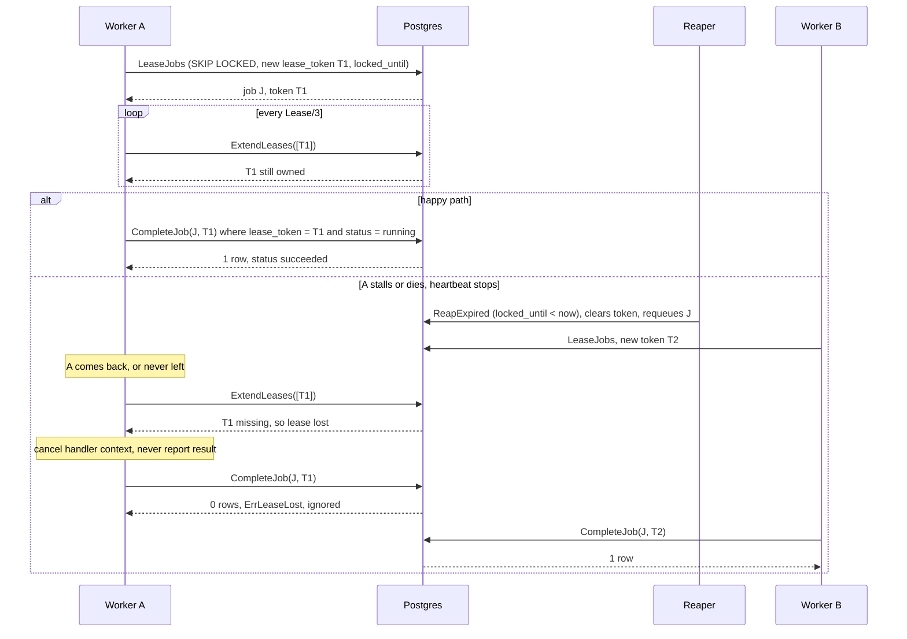

# Design notes and trade-offs

This is the "why" document for Tandem (module and binaries are named `taskq`). The README says what the system does; this says what it chose not to do, what that costs, and where it will break. Claims here are about the code in this repository; where something is a hypothesis rather than a measurement, it says so.

Contents: [at-least-once](#why-at-least-once) | [Postgres](#why-postgres-as-the-queue) | [Redis](#why-redis-is-never-on-the-correctness-path) | [leader election](#leader-election-is-an-optimisation) | [10x and 100x](#what-breaks-at-10x-and-100x) | [limitations](#known-limitations-and-non-goals)

## The lifecycle in one picture

Lease expiry is judged by Postgres (`locked_until < now()` in SQL), never by a worker's clock, so worker clock skew cannot cause or hide an expiry.

## Why at-least-once

There are three delivery semantics a queue can offer.

**At-most-once** means a job is handed out once and never again. A worker that dies mid-job takes the job with it. That is the opposite of the property wanted here (an accepted job is never lost), so it is out.

**Exactly-once** would mean the handler's side effects happen once and only once, across crashes. That needs the side effect and the "done" record to commit atomically. This queue controls only the second half. The handler can do anything: send an email, call a payment API, write to a different database. For an arbitrary handler there is no transaction spanning that effect and the `UPDATE jobs SET status='succeeded'`. Whenever a worker can die between the effect and the record, you must choose to re-run (possible duplicate) or not re-run (possible loss). Exactly-once is achievable only when the effect is itself transactional with the queue (the handler writes to the same Postgres in the same transaction) or when the downstream system deduplicates (an idempotency key it honors). Systems that advertise exactly-once either restrict the effects to something they control or are really at-least-once plus deduplication. This project says so up front instead.

**At-least-once** is what it provides: reclaim anything whose owner went quiet, and run it again. The cost is duplicates, so the design is about making them safe and bounded:

- **Fencing tokens.** Every lease gets a fresh `lease_token`. `CompleteJob`, `FailJob` and `ExtendLeases` only match `lease_token = $token AND status = 'running'`. Anything that takes a job from its worker (reaper, cancel) clears the token. A worker that was presumed dead and comes back cannot overwrite the state written by whoever owns the job now. This protects the queue's own state.
- **Heartbeat as the other half.** When the heartbeat shows the token gone, the worker cancels the handler's context and drops the result without reporting it.
- **Idempotency keys.** `(tenant_id, idempotency_key)` is a unique index, so a client that retries a submit after a timeout gets the original job back instead of a second one. Schedule fires use the same mechanism (`sched:<id>:<fire time>`).
- **Bounded attempts.** The attempt counter is incremented at lease time, so a "poison" job that crashes its worker every time still burns an attempt per crash and ends in `dead` after `max_attempts`. The reaper does the same accounting.
- **An audit trail.** `job_attempts` records every lease with its outcome (`succeeded`, `failed`, `lease_expired`, `cancelled`). The chaos test uses it to count duplicates, so they are visible rather than hypothetical.

**Where duplicates still happen.** Fencing stops a stale worker from *reporting*; it cannot stop a stale worker from *doing*. Concretely:

1. A worker finishes the side effect, then is SIGKILLed before `CompleteJob`. The job is reaped and run again. (The chaos run counts these: in a 10,000-job run, 36 `sleep` jobs ran more than once.)
2. A handler is slow, or its process is paused (GC, a stopped container, a network partition from Postgres), so heartbeats stop and the lease expires. The reaper requeues the job and worker B runs it while worker A's handler may still be executing. A's result is rejected, but any external effects A has performed or goes on to perform happen anyway, until A notices on its next heartbeat and cancels the context. Cancellation is cooperative: a handler that ignores `ctx` keeps going.
3. The heartbeat call fails for a full lease. The worker cannot know whether it still owns the job, so it cancels the handler (`ErrLeaseUncertain`); the job may be re-run.
4. A forced shutdown after `ShutdownTimeout` abandons in-flight jobs on purpose and leaves them for the reaper.
5. The report itself fails (`report_error`). If the commit did not happen, the job stays `running` until its lease expires and then runs again.

What handlers are expected to do: be idempotent, or pass the job id (stable across attempts) as the idempotency key to whatever they call. The handler receives the whole job row, including `id` and `attempts`.

"Accepted never lost" has one more precondition worth stating: it is exactly as durable as the Postgres commit that preceded the 202. There is a single primary and no HA configuration here; a Postgres host that loses committed data loses accepted jobs.

## Why Postgres as the queue

The alternatives considered were Kafka, RabbitMQ and Redis lists/streams. The deciding factors:

- **State transitions are single statements.** Leasing is one statement (pick with `SKIP LOCKED`, update status and token, insert the attempt row). Completing, failing, reaping, cancelling and firing a schedule are each one statement too. There is no multi-step protocol to crash in the middle of, so there is no intermediate state to recover. With a separate broker plus a database for status you need an outbox or you accept that "enqueued" and "recorded" can disagree.
- **`FOR UPDATE SKIP LOCKED`** makes a table behave like a work queue: concurrent workers (and reaper replicas) take disjoint rows without blocking each other. The lock is held only for the statement, not for the job. Leases are rows, not open transactions, so a dead worker holds no locks and no long transaction pins vacuum.
- **One dependency, queryable state.** "Why is this job stuck", "list this tenant's dead jobs", the chaos test's invariants and the Grafana queue-depth panels are all plain SQL.
- **Idempotency is a constraint.** A partial unique index plus `ON CONFLICT DO NOTHING` is the entire dedupe implementation, and it holds across API replicas and schedulers without coordination.
- **Dequeue is cheap if indexed.** The partial index `jobs_queued_idx (queue, priority DESC, run_at) WHERE status='queued'` gave a 0.024 ms dequeue on 500,000 rows versus 44.9-52.3 ms without it (see [loadtest/RESULTS.md](loadtest/RESULTS.md)).

Why not the others, specifically for this job:

- **Kafka** is a log, not a work queue. Parallelism is bounded by partitions, one slow message blocks the messages behind it in its partition, and there is no per-message ack, delay, retry-at-time or priority. You would rebuild leases, retries and a status store around it. It is the right tool for fan-out and replay, which this system does not need.
- **RabbitMQ** has acks and redelivery and would be a reasonable queue. But job status, idempotent submit and "list my jobs" still need a database, which brings back the dual-write problem, and delayed and priority delivery need extra configuration.
- **Redis as the queue** puts the durability of "accepted" on AOF/replication settings and failover behavior, where acknowledged writes can be lost. Atomic leasing needs Lua scripts, and ad-hoc queries over state are weak. Redis is used here, but only for things that may be lost (next section).

**What you give up:**

- **A throughput ceiling.** Everything funnels through one Postgres primary's write capacity. Scaling is vertical, then sharding queues across databases (see below).
- **Write amplification.** Each job writes the `jobs` row on insert, lease and completion, and writes a `job_attempts` row on insert and again on completion. Heartbeats rewrite `locked_until` on every in-flight job every `Lease/3`. `locked_until` is the key of `jobs_running_idx`, and `status` is in several partial index predicates, so these updates cannot be HOT (heap-only) updates and each touches indexes.
- **Vacuum and bloat on a hot table.** Constant updates create dead tuples at a rate proportional to throughput, and finished jobs stay in the same table.
- **No fan-out and no replay.** A job goes to exactly one worker. There are no consumer groups reading the same stream, and a finished job is not an event a new consumer can reprocess.
- **Poll latency.** Workers poll; without hints, a job waits up to a poll interval (500 ms default, jittered). Redis wake-ups cut this, but they are only hints.

## Why Redis is never on the correctness path

Redis is optional (`REDIS_URL` empty means all three features are off) and every feature treats a Redis error as "feature unavailable", never as "operation failed". The invariant: **killing Redis must not lose, duplicate or strand a job.**

| Feature | Where | If Redis is down or wrong |
| --- | --- | --- |
| Submit rate limit (token bucket in Lua, per tenant) | `internal/ratelimit`, `POST /v1/jobs` only | **Fails open.** An error from the limiter logs a warning and the request proceeds. The limiter protects the system from a noisy tenant; it is not a correctness mechanism, and refusing all submits because the limiter is sick would trade a soft problem for a hard outage. Cost: during the outage there is no limit. |
| Job status cache | `internal/statuscache`, `GET /v1/jobs/{id}` | **Falls back to Postgres.** Any error is a cache miss. |
| Enqueue wake-ups (pub/sub) | `internal/wake` | **Falls back to polling.** A lost, late or failed wake-up costs at most one poll interval. Publishing is bounded to 100 ms and ignores errors; subscribers reconnect with capped backoff. |

**The status cache stores terminal rows only** (`succeeded`, `dead`, `cancelled`), and `Set` enforces that itself. A running job's row changes constantly (status, attempts, `locked_until`), so caching it would serve stale lies; a terminal row is effectively immutable. The one way out of a terminal state is an API-side requeue, which deletes the cache key *before* it responds. A race remains: a `GET` reads the terminal row from Postgres, a requeue commits and deletes the key, and then the `GET` calls `Set`. That leaves a stale terminal entry. It is bounded to one TTL (`STATUS_CACHE_TTL_MS`, default 10 s), and it is stale only about a job that was just requeued by someone else. This is a conscious trade of a bounded, rare staleness for a simple design with no invalidation protocol. Tenant checks are applied to cache hits the same as to database reads.

**Wake-ups only fire for jobs runnable now.** Future-dated jobs, retries after backoff and reaped jobs are picked up by polling. The wake-up channel carries the queue name, but subscribers ignore it and wake on any message (a worker on an unrelated queue wakes, finds nothing, and sleeps again).

**The go-redis retry lesson.** Every Redis call here already treated an error as "ignore it", but with go-redis's defaults a stopped Redis still cost about 6 seconds per call (the note is in `internal/redisx/redisx.go`). The cause is that go-redis retries by default: `MaxRetries` 0 means "use the default of 3" (only -1 disables retries), and failed dials are retried 5 times by default. Fail-open is worthless if the failure path is slow, because each submit would wait out the retries before being allowed through. The client now sets `MaxRetries = -1` (none; the explicit sentinel), `DialerRetries = 1`, 200 ms dial and 100 ms read/write timeouts, a 200 ms pool timeout, and `ContextTimeoutEnabled` so the wake publisher's own 100 ms budget is honored. The general rule: "optional dependency" has to be a property of the timeouts, not only of the error handling.

## Leader election is an optimisation

The scheduler runs two processes. The reaper runs on **every** replica; it is safe because `ReapExpired` uses `SKIP LOCKED` and each replica takes a disjoint batch. The cron runner runs only under a leader lock: a Postgres session advisory lock (`pg_try_advisory_lock`) held on a dedicated connection, so it is released automatically if the process or connection dies. A leader re-checks that it still holds the lock every `LEADER_CHECK_MS`, and followers retry every `LEADER_RETRY_MS`.

The lock is **not** what prevents double-firing, because any lock can be wrong at the wrong moment (a leader that lost its connection but has not noticed, a long pause, a split between check and use). The actual guard is `FireSchedule`: one statement that updates the schedule row `WHERE next_fire_at = <the value I read> AND enabled`, and inserts the job only from the rows that update returned. Of any number of concurrent callers with the same view, exactly one advances `next_fire_at`; the rest affect zero rows. As a second, independent guard the inserted job carries the idempotency key `sched:<id>:<fire unix seconds>`, so even if the schedule row were re-armed to the same instant another way, the second insert conflicts. So leadership only saves the wasted `DueSchedules` queries and CAS attempts of the non-leaders. `TestFireScheduleConcurrent` and `TestE2ENoElectionNoDuplicateFires` exercise exactly this: concurrent firing with no election in front of it.

Related behavior: the next fire is computed from `max(now, next_fire_at)`, so after a long outage the missed occurrences collapse into one catch-up fire, not a backfill. Resuming a paused schedule recomputes `next_fire_at`, so it also does not replay.

## What breaks at 10x and 100x

For scale: the load tests in [loadtest/RESULTS.md](loadtest/RESULTS.md) topped out around 1,000 submits per second on a laptop with everything co-located, without finding the real ceiling. The table below is reasoning from the code, not measurement; "symptom" names the panel or signal you would see on the existing Grafana dashboard where one exists, and says so where the stack has no signal at all (there is no Postgres exporter in this compose file).

| Pressure | Why, in this code | Symptom | Fix |
| --- | --- | --- | --- |
| **Single primary write throughput** | Every job costs several writes (insert, lease, complete, two `job_attempts` writes) plus heartbeat updates for every in-flight job. | "Lease latency p95" and "API latency" (`POST /v1/jobs` p99) rise; "Queue depth" and "Oldest queued job age" grow while "In-flight jobs per worker" sits below the cap. | Tune first (checkpoints, faster storage, larger lease to cut heartbeat writes). Then shard queues across databases (a queue maps to one Postgres), since a queue is the natural partition key. Move status reads to replicas. |
| **Connection count** | Every API replica, worker and scheduler opens its own pgx pool (library defaults; `store.Open` does not size it), and the scheduler pins one more connection for the leader lock. Connections scale with process count. | `FATAL: too many clients` in logs, "lease failed" errors with retries, `/readyz` returning 503 and replicas flapping. | PgBouncer in transaction mode, with two caveats: the leader lock is a *session* advisory lock, so that connection must go directly to Postgres (or the lock needs another mechanism); and prepared-statement settings in pgx must match the pooler. Also fewer, larger workers. |
| **Hot `jobs` table bloat** | Finished jobs are never deleted, and the table takes constant non-HOT updates. The partial indexes keep dequeue independent of finished rows (verified with `EXPLAIN` at 500k rows), but the heap, the non-partial indexes (`jobs_tenant_*`) and vacuum work all grow. | Lease latency creeping up over days, table and index size growing, autovacuum falling behind. No dashboard panel shows this today; you would find it in Postgres stats. | Archive or delete terminal jobs on a schedule; partition `jobs` by `created_at` and drop old partitions; tighter per-table autovacuum settings. Caveat: partitioning forces the partition key into every unique index, which breaks the global `(tenant_id, idempotency_key)` guarantee across partitions, so idempotency would need a separate (smaller, expiring) dedupe table. |
| **`job_attempts` growth, no retention** | One row per attempt, kept forever, cascade-deleted only with the job. Retried and reaped jobs multiply it, and every lease inserts with a foreign-key check. | Same as above, concentrated in this table; slower leases (the FK trigger is part of the lease statement). | Time-partition and drop, or keep only the last N attempts per job; ship history to cold storage if it is needed. |
| **Queue-depth query over the whole table** | `QueueStats` is `SELECT queue, status, count(*), min(run_at) FILTER ... FROM jobs GROUP BY 1, 2` with no `WHERE`, so its cost grows with all rows including finished ones. It is cached for 5 s, and each of the 2 scheduler replicas runs it. | Periodic DB CPU spikes; the 2 s query timeout trips, so the collector serves the last snapshot and logs "queue depth scrape failed": the "Queue depth" panel goes flat and the "Oldest queued job age" panel goes stale while the backlog moves. | Count only live statuses from the partial indexes and take terminal counts from counters (`attempts/sec by outcome` already exists); or use estimated counts; or run it against a replica. |
| **Idle polling** | Each idle worker polls `LeaseJobs` per queue about every 500 ms (jittered), and wake-ups only cut a sleep short; they do not replace polling. The poll interval is a `worker.Config` field that `cmd/worker` does not expose as an env var. Each empty poll is cheap (0.024 ms of plan time at 500k rows) but is still a round trip and a transaction. | Postgres TPS and CPU that do not fall when the queue is empty; high call counts for the lease statement. | Make the poll interval configurable and lengthen it when wake-ups are healthy; per-queue wake channels so only relevant workers wake; or Postgres `LISTEN/NOTIFY` so wake-ups do not depend on Redis. At 100x, a 1-in-N chance that any given idle worker gets the job also means most woken workers lease nothing, so shard subscribers by queue. |
| **API key revocation lag** | `APIKeyAuth` caches successful lookups per replica in memory for 30 s, and failures are not cached. A revoked key keeps working on each replica until its entry expires. | None on the dashboard; this is a security-latency property. It scales with replica count only in the sense of more places to wait out. | Shorter TTL, a revocation channel (Redis pub/sub or `LISTEN/NOTIFY`) that evicts entries, or a revocation check against a small shared set. |
| **Unbounded `queue` label cardinality** | `queue` is a client-supplied string (up to 255 chars) and becomes a label on `taskq_jobs_submitted_total` and, via `QueueStats`, on `taskq_jobs{queue,status}` (6 series per distinct queue) and the oldest-age gauge. Job `type` is safe (unregistered types are mapped to `unknown`); queue is not. | Prometheus memory and series count climbing, slow dashboard queries, growing scrape size. | Validate queues against a per-tenant allowlist or cap, bucket unknown queues into `other` in metrics, or drop the label from the submit counter. |

Smaller things that appear at 100x: nginx is a single front door and has no TLS; Redis is a single node (fail-open means its loss costs the limiter, cache and hints but not correctness); the dashboard's `max by (queue,status)` is there because both scheduler replicas export identical depth series, and a real fix is to export it from one place.

## Known limitations and non-goals

- **No exactly-once.** See above. Handlers must tolerate re-execution.
- **No real multi-tenant isolation.** The tenant comes from an API key (or from an unauthenticated header in `AUTH_MODE=header`, the binary's default, which is development only). Tenants share queues and the worker pool: there is no per-tenant concurrency limit or fair scheduling, so a tenant that submits a large backlog delays others in the same queue. The only per-tenant protection is the submit rate limit, which needs Redis and fails open. Keys have no scopes or expiry, and `taskq-admin` talks to the database directly.
- **Handlers are compiled in.** Job types are the built-ins (`sleep`, `flaky`, `http`) registered in the worker binary; there is no plugin or remote-handler mechanism. The `http` handler requests any URL in the payload and so can reach any host the worker can, including internal ones; do not expose it to untrusted tenants.
- **No workflow DAGs.** A job has no dependencies, fan-in or fan-out, and no result storage beyond status and `last_error`.
- **Cancel is cooperative and delayed.** A running job is fenced out immediately, but the handler notices at its next heartbeat (up to `Lease/3`), and a handler that ignores its context keeps running.
- **Observability and network exposure are development-grade.** `/metrics` is served by every API replica outside authentication and is protected only by nginx not proxying it (and by the network). Worker and scheduler metrics listen on `:9090` unauthenticated. Grafana allows anonymous Viewer access, Prometheus is unauthenticated and published on a host port, and Postgres is published on 5432 with a fixed dev password. No TLS anywhere.
- **No retention or archival** of jobs or attempts (see the 10x table), and no Postgres HA or backup story.
- **Priority is strict.** `ORDER BY priority DESC, run_at` means a steady stream of high-priority jobs can starve lower ones in the same queue.
- **Load numbers are single-machine samples** with every component and the load generator sharing one laptop; they say the system behaves sanely, not how fast it can go.
