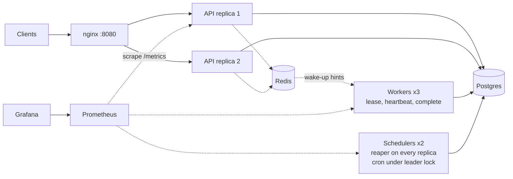

# Tandem

A distributed task execution platform (a small Celery): clients submit jobs over HTTP, workers lease and run them from a Postgres-backed queue, and a scheduler reclaims the jobs of dead workers and fires cron schedules. Go, Postgres 17, optional Redis, Prometheus and Grafana.

The guarantee is **at-least-once execution: a job the API accepted (HTTP 202) is never lost or left stuck, even when workers are SIGKILLed mid-job.** Duplicate executions can happen and are made safe by lease fencing (a worker that lost its lease cannot write a result) and idempotency keys (submit replays return the original job). **Exactly-once is explicitly not promised**; see [DESIGN.md](DESIGN.md) for why.

(The Go module and binaries are still named `taskq`; Tandem is the project name.)

## Architecture



Solid lines are the correctness path; dotted lines are optional or observational. Redis carries three best-effort features (per-tenant submit rate limit, terminal-job status cache, enqueue wake-ups). With `REDIS_URL` unset, or Redis down, the system keeps working: workers poll, nothing is cached, nothing is rate limited. Prometheus scrapes the API replicas directly, because nginx deliberately returns 404 for `/metrics`.

One Go module, one Docker image, three service binaries selected by the compose `command` (`api`, `worker`, `scheduler`), plus `taskq-admin` (API keys) and `chaos` (the failure test).

## How it works

Every state transition is a single SQL statement (data-modifying CTEs), so the invariants live in Postgres rather than in application code. Depth and trade-offs are in [DESIGN.md](DESIGN.md).

- **Leasing.** `LeaseJobs` picks due jobs with `FOR UPDATE SKIP LOCKED`, marks them `running`, assigns each a fresh `lease_token` and `locked_until`, and opens a `job_attempts` row, all in one statement. Concurrent workers skip rows another worker is claiming instead of blocking. A worker never holds more than `WORKER_CONCURRENCY` jobs.
- **Fencing.** `CompleteJob`, `FailJob` and `ExtendLeases` match on `lease_token AND status='running'`. Anything that takes a job away from its worker (the reaper, cancel) clears the token, so the old owner's later writes affect zero rows.
- **Heartbeats.** Each worker extends all its in-flight leases in one `ExtendLeases` call every `Lease/3`. A token missing from the result means the lease was lost: the handler's context is cancelled and its result is never reported.
- **Reaper.** `ReapExpired` reclaims `running` jobs past `locked_until` (requeue, or `dead` if attempts are exhausted), with `SKIP LOCKED`, so every scheduler replica runs it with no leader. It leaves `run_at` alone, so reclaimed jobs keep their place at the front of the queue.
- **Retries and dead letters.** A failed handler goes through `FailJob`: requeued with exponential backoff and full jitter, or moved to `dead` when `max_attempts` is reached or the handler returned `worker.Permanent(err)`. `dead` is the dead-letter queue; `POST /v1/jobs/{id}/requeue` gives a dead job a fresh set of attempts.
- **Cron.** `FireSchedule` is a compare-and-swap on `next_fire_at` plus a job idempotency key `sched:<id>:<fire unix seconds>`, so a schedule cannot double-fire even if two schedulers both run the cron loop. A Postgres advisory lock elects a cron leader, but only to avoid wasted work. After an outage, missed fires collapse into one catch-up fire.
- **Idempotent submit.** `Idempotency-Key` plus the tenant is a unique index; the insert is `ON CONFLICT DO NOTHING` followed by a select, so a replay returns the original job.
- **Cancel.** `CancelJob` moves a queued or running job to `cancelled` and clears its lease token; the worker finds out on its next heartbeat and cancels the handler. There is no cancel-specific worker code.

## Proof

### Chaos test

`cmd/chaos` runs against a real compose stack with short timings (5 s lease, 4 workers x 20 slots, see `deploy/docker-compose.chaos.yml`). It submits N jobs with idempotency keys (80% `sleep`, 15% `flaky` at 50% failure, 5% `flaky` at 100% failure) while SIGKILLing a random worker every `-kill-every` and, every fourth round, a scheduler, restarting each 1-2 s later. When the queue drains it checks eight invariants directly in Postgres:

1. exactly N jobs exist (none lost, none duplicated at submit)
2. every job ended `succeeded` or `dead` (none stuck)
3. `attempts <= max_attempts`, and every `dead` job used all its attempts
4. every always-failing job is `dead`
5. `job_attempts` rows match `attempts`, none left open
6. every `succeeded` job has exactly one succeeded attempt, and it is the last one
7. no terminal job still carries a lease token or `locked_until`
8. chaos actually happened (kills occurred and `lease_expired` attempts exist)

It exits non-zero if any fails. See [chaos/README.md](chaos/README.md) for how to read the report.

One run while writing these docs (10,000 jobs, `-kill-every 1500ms`, laptop under Docker Desktop): all eight invariants passed; 3 worker kills; 37 `lease_expired` attempts, 36 of them re-executions of `sleep` jobs (the at-least-once duplicates, visible and counted); time-to-detect (lease start to reap) p50 5.35 s, in line with the 5 s lease; time-to-re-lease (reap to next attempt) p50 0.04 s, p95 0.20 s. A short run on one machine, not a statistical claim.

### Load tests and dequeue plan

Full method and caveats are in [loadtest/RESULTS.md](loadtest/RESULTS.md). **Everything ran on one Windows laptop with Postgres, Redis, 2 API replicas, nginx, 3 workers, 2 schedulers, Prometheus, Grafana and k6 all sharing the same CPUs.** Runs were 30-55 s, single samples, with 20-50 ms `sleep` handlers. These are sanity numbers, not capacity claims.

| Run | Result |
| --- | --- |
| Submit, 200/s target | 9,549 requests, 0 errors, p95 3.4 ms |
| Submit, 1000/s target | 37,389 requests, 0 errors, about 830 req/s averaged over the whole run (k6 ran out of VUs, so the target was not fully sustained), p95 42 ms |
| End to end at 50/s (submit, then poll until `succeeded`) | 2,500 jobs, 0 failures, submit-to-done p50 58 ms, p95 109 ms (includes a 50 ms handler and a 50 ms poll interval) |
| Limiter on, 150/s offered against a 50/s limit | 1,925 of 3,424 requests got 429, none counted as errors |

Dequeue query, `EXPLAIN ANALYZE` on 500,000 seeded jobs (about 25k queued): with the partial index `jobs_queued_idx (queue, priority DESC, run_at) WHERE status='queued'` the plan is an index scan with no sort, **0.024 ms** warm. Without it, a sequential scan plus sort took **44.9-52.3 ms**, and that cost grows with table size while the indexed plan does not. No index change was needed.

## Quickstart

Needs Docker. Everything below was run against this repo's compose files.

```bash
# 1. Postgres, Redis, 2 API replicas behind nginx, 3 workers, 2 schedulers, Prometheus, Grafana
docker compose -f deploy/docker-compose.yml up -d --build

# 2. Create an API key (printed once; the compose stack runs with AUTH_MODE=apikey)
docker compose -f deploy/docker-compose.yml exec api taskq-admin create-key -tenant demo -name quickstart
export API_KEY=tq_...   # paste the key it printed

# 3. Submit a job (202 Accepted)
curl -s -X POST localhost:8080/v1/jobs \
  -H "Authorization: Bearer $API_KEY" -H "Idempotency-Key: hello-1" \
  -d '{"type":"sleep","payload":{"ms":500}}'

# 4. Check status with the id from the response (queued -> running -> succeeded)
curl -s localhost:8080/v1/jobs/<id> -H "Authorization: Bearer $API_KEY"

# 5. Dashboard (anonymous viewer, dev only): http://localhost:3000
#    Prometheus: http://localhost:9091
```

Built-in handlers: `sleep` (`{"ms": n}`), `flaky` (`{"fail_rate": 0.5}`) and `http` (`{"url": "...", "method": "POST", "body": "...", "timeout_ms": 10000}`; any non-2xx is a failure). A cron schedule:

```bash
curl -s -X POST localhost:8080/v1/schedules -H "Authorization: Bearer $API_KEY" \
  -d '{"name":"every-minute","cron":"* * * * *","type":"sleep","payload":{"ms":10}}'
```

Tear down with `docker compose -f deploy/docker-compose.yml down -v`. To reproduce the failure test or the load tests, see [chaos/README.md](chaos/README.md) and [loadtest/README.md](loadtest/README.md). A scripted two-minute walkthrough of killing workers while watching the dashboard is in [demo/DEMO.md](demo/DEMO.md).

## API

Authentication: `Authorization: Bearer tq_...` or `X-API-Key`. The tenant comes from the key. With `AUTH_MODE=header` (the binary's default, used by the chaos override) the tenant is the unauthenticated `X-Tenant-ID` header; that is for development only. Cross-tenant access returns 404, not 403.

| Method and path | Purpose |
| --- | --- |
| `POST /v1/jobs` | Submit (`type`, `queue`, `payload`, `priority`, `run_at`, `max_attempts`); optional `Idempotency-Key` header; 202, or 429 with `Retry-After` when rate limited |
| `GET /v1/jobs/{id}` | Job status |
| `GET /v1/jobs` | List newest first; `status`, `queue`, `limit` (max 200), opaque `cursor` |
| `POST /v1/jobs/{id}/cancel` | Cancel a queued or running job (409 otherwise) |
| `POST /v1/jobs/{id}/requeue` | Give a `dead` job a fresh set of attempts (409 otherwise) |
| `POST /v1/schedules` | Create a cron schedule (`name`, `cron`, `timezone`, job template) |
| `GET /v1/schedules`, `GET /v1/schedules/{id}` | List, fetch |
| `DELETE /v1/schedules/{id}` | Delete (jobs already created are kept) |
| `POST /v1/schedules/{id}/pause`, `.../resume` | Pause, resume (resume does not replay missed fires) |
| `GET /healthz`, `GET /readyz` | Liveness, readiness (pings Postgres) |
| `GET /metrics` | Prometheus metrics; served by the API process, blocked by nginx |

## Configuration

All configuration is environment variables with defaults in [`internal/config/config.go`](internal/config/config.go). The ones you will touch:

| Variable | Default | Meaning |
| --- | --- | --- |
| `DATABASE_URL` | local Postgres | Postgres DSN (the API migrates on startup; workers and schedulers do not) |
| `REDIS_URL` | empty | Empty turns all Redis features off |
| `AUTH_MODE` | `header` | `apikey` for real keys; compose sets it |
| `WORKER_QUEUES`, `WORKER_CONCURRENCY` | `default`, 10 | Queues a worker serves, and max in-flight jobs per worker |
| `LEASE_SECONDS` | 30 | Lease length; heartbeat runs every third of it |
| `JOB_TIMEOUT_SECONDS` | 900 | Per-attempt handler deadline |
| `RETRY_BASE_MS`, `RETRY_MAX_MS` | 1000, 300000 | Exponential backoff base and cap |
| `REAP_INTERVAL_MS`, `REAP_BATCH` | 1000, 500 | Reaper cadence and batch size |
| `CRON_INTERVAL_MS`, `LEADER_RETRY_MS`, `LEADER_CHECK_MS` | 1000, 2000, 1000 | Cron loop and leader election timing |
| `RATELIMIT_ENABLED`, `RATELIMIT_RATE_PER_SEC`, `RATELIMIT_BURST` | true, 50, 100 | Per-tenant submit limit (needs Redis) |
| `STATUS_CACHE_TTL_MS` | 10000 | Terminal-job cache TTL; 0 disables (needs Redis) |
| `WAKE_ENABLED` | true | Enqueue wake-ups (needs Redis) |
| `METRICS_ADDR` | `:9090` | Worker and scheduler `/metrics` listener |

## Repository layout

```
cmd/api, cmd/worker, cmd/scheduler   service binaries
cmd/taskq-admin                      API key management (create-key, revoke-key, list-keys)
cmd/chaos                            SIGKILL failure test with invariant checker
internal/store                       all SQL state transitions and migrations (the core)
internal/worker                      lease loop, heartbeats, handler registry, built-in handlers
internal/scheduler                   reaper, cron runner, leader election
internal/api                         chi router, auth, middleware
internal/redisx, ratelimit,
  statuscache, wake                  optional Redis features
internal/metrics                     Prometheus metrics
internal/queue, cronexpr, config     backoff, cron parser, env config
deploy/                              compose files, nginx, Prometheus, Grafana provisioning
chaos/, loadtest/                    test docs, k6 scripts, results
```

## Running the tests

```bash
go build ./... && go vet ./...
go test ./... -count=1        # needs Docker: testcontainers starts postgres:17 (and Redis for those packages)
```

Almost every package tests against real Postgres rather than mocks. CI (`.github/workflows/ci.yml`) runs gofmt, build, vet and `go test ./... -count=1 -p 2 -race`; `-race` needs a C toolchain, so it is not run on the Windows dev machine. Unit-level tests coordinate with channels and injected clocks rather than sleeps.

## Known limitations

Short list; the full one is in [DESIGN.md](DESIGN.md). No exactly-once. API keys give tenant separation but there are no per-tenant quotas beyond the submit rate limit. No workflow DAGs. `/metrics` is unauthenticated inside the network, and Grafana and Prometheus in the compose file are open for development.
